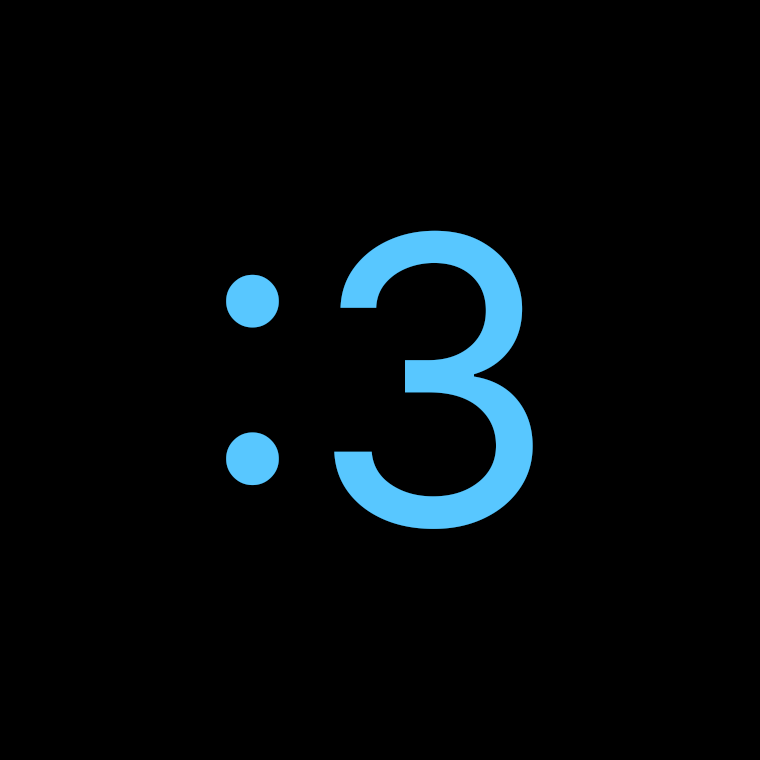

# 🥭 MangoWM Gruvbox Rice

<p align="center">
  
</p>

<p align="center">
  <b>A smooth, modern, and aesthetic Gruvbox Dark setup for MangoWM on Wayland.</b>
</p>

<p align="center">
  
  
  
  
</p>

---

## ✨ Features

- **Window Compositor**: [MangoWM](https://github.com/DreamMaoMao/mangowm) (MangoWC 0.18.0) featuring **SceneFX** (dual-pass blur, floating window shadows, rounded corners, and smooth zoom/slide animations).
- **Status Bar**: [Waybar](https://github.com/Alexays/Waybar) styled in Gruvbox with workspaces/tags, active taskbar, and audio/system widgets.
- **Application Launcher**: [Rofi](https://github.com/davatorium/rofi) configured with custom Gruvbox colors and JetBrainsMono Nerd Font.
- **Terminal**: [Kitty](https://sw.kovidgoyal.net/kitty/) with native Gruvbox Dark palette.
- **Notification Daemon**: [SwayNC](https://github.com/ErikReider/SwayNotificationCenter) with dark minimal card widgets.
- **Dynamic Wallpaper Engine**: Automated script powered by `awww` featuring 165Hz cubic-bezier animated transitions (`grow`, `wave`, `outer`, `wipe`).
- **Display Optimization**: Default profile tuned for Ultrawide 3440x1440 @ 165Hz (easily configurable for any monitor in `mango/config.conf`).

## WARNING!
Pls if your read it remember. This solution notfor new users in linux.


---

## 📂 Repository Structure

```text
.
├── .config/
│   ├── kitty/       # Terminal colors and typography
│   ├── mango/       # MangoWM compositor config and wallpaper script
│   ├── rofi/        # Application launcher theme
│   ├── swaync/      # Notification center configuration and styles
│   └── waybar/      # Top bar layout and Gruvbox stylesheets
├── install.sh       # Safe installation script
├── LICENSE          # MIT License
└── README.md        # Documentation
```

---

## ⌨️ Keybindings Cheat Sheet

The default modifier key is `SUPER` (`Win` key):

| Keybinding | Action |
| :--- | :--- |
| `SUPER + Return` | Launch **Kitty** terminal |
| `SUPER + d` | Open **Rofi** application menu |
| `SUPER + n` | Toggle **SwayNC** notification center |
| `SUPER + w` | Cycle random wallpaper with 165Hz transition |
| `SUPER + q` | Close focused window (`killclient`) |
| `SUPER + r` | Reload MangoWM configuration on the fly |
| `SUPER + Space` | Toggle floating mode for focused window |
| `SUPER + f` | Cycle layout modes |
| `SUPER + Shift + f` | Toggle fullscreen |
| `SUPER + v` | Toggle Dwindle split direction (horizontal/vertical) |
| `SUPER + Tab` | Cycle window focus |
| `SUPER + Arrows` | Focus window in directional grid |
| `SUPER + Shift + Arrows` | Move active window in directional grid |
| `SUPER + 1..9` | Switch to workspace / tag 1–9 |
| `SUPER + Shift + 1..9` | Move window to workspace / tag 1–9 |
| `SUPER + Shift + s` | Interactive screenshot area & annotate with **Satty** (auto-copies to clipboard) |
| `SUPER + l` | Lock screen (`hyprlock`) |
| `SUPER + Shift + e` | Exit MangoWM |

---

## 🚀 Installation

## 🚀 Quick Installation

### Method 1: The One-Liner (Fastest) ⚡
Run this single command in your terminal to download and install the rice interactively:

```bash
bash <(curl -sSL https://raw.githubusercontent.com/davidykmisha2015-prog/MyGruvboxMangoWMdotfile/main/install.sh)
```

The script automatically:
1. Asks for your confirmation.
2. Creates an automatic timestamped backup of any existing configs in `~/.config/mangowm_backup_<timestamp>/`.
3. Installs all configurations (`mango`, `waybar`, `swaync`, `rofi`, `kitty`).
4. Checks which dependencies are present on your system.

---

### Method 2: Manual Git Clone
If you prefer inspecting the code first:

```bash
# 1. Clone this repository
git clone https://github.com/davidykmisha2015-prog/MyGruvboxMangoWMdotfile.git ~/mangowm-dotfiles
cd ~/mangowm-dotfiles

# 2. Run the interactive installer
./install.sh
```

*(Optional)* Or link files using GNU Stow:
```bash
stow .
```

### 3. Dependencies
Ensure the following packages are installed on your system (e.g. via `nix-env`, `pacman`, or your distribution package manager):
- `mangowm` (or `mangowc`)
- `waybar`
- `swaynotificationcenter` (`swaync`)
- `rofi-wayland`
- `kitty`
- `awww` (wallpaper daemon)
- `nerd-fonts.jetbrains-mono` (or `JetBrainsMono Nerd Font`)

---

## 🎨 Palette (Gruvbox Dark)

- **Background**: `#282828`
- **Current / Active**: `#d65d0e` / `#83a598`
- **Foreground / Text**: `#ebdbb2`
- **Alt Accent**: `#fabd2f`

---

## 👤 Author

Created and maintained with love by **David** ([@davidykmisha2015-prog](https://github.com/davidykmisha2015-prog)) from Chernihiv, Ukraine 🇺🇦.
Feel free to open issues or star the repository if you enjoy the rice!
